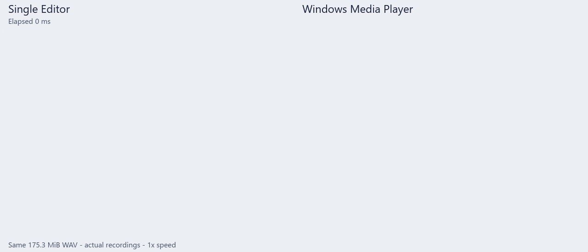

# Single Editor

**一个能看见波形、也能直接编辑的轻量音频播放器。**

打开声音，马上播放；看一眼波形，找到需要的位置；调整增益、做一段淡入淡出，或删掉不需要的片段，再保存下来。Single Editor（SE）希望把这些日常操作放进一个轻快、直接的窗口。

当前面向 **Windows x64**，**v0.1.1 公开预览版**提供便携包和当前用户安装包。

[下载 v0.1.1](https://github.com/TATPEACH/SingleEditor/releases/tag/v0.1.1) · [便携 ZIP](https://github.com/TATPEACH/SingleEditor/releases/download/v0.1.1/SingleEditor-v0.1.1-windows-x64-portable.zip) · [安装包](https://github.com/TATPEACH/SingleEditor/releases/download/v0.1.1/SingleEditor-v0.1.1-windows-x64-setup.exe)

[操作手册](MANUAL.md) · [新电脑开发](docs/DEVELOPMENT.md) · [构建指南](BUILDING.md) · [贡献指南](CONTRIBUTING.md)

## 设计哲学

### 打开、看见、听到

播放、波形预览和基本编辑是 SE 的核心。打开普通音频时，优先让文件可播放、首帧波形可见；扩展面板和特殊格式的处理按需启用。速度要体现在每天反复打开文件的过程中。

### 轻量，也留出编辑的余地

听到一个问题，能在同一个窗口里定位并修改。SE 从单个音频文件出发，把选区、增益、淡入淡出、删除、撤销和保存做成直接的操作，让播放器也能承担常见的编辑工作。

### 需要多少，展开多少

用 Simple 模式专注听音和波形，用 General 模式展开工作区。播放列表、文件信息、电平表、EQ、Limiter 等功能以 **Mag（功能面板）** 组织，按需要打开、停靠或浮动。

### 编辑结果应该清楚

监听音量与写入文件的编辑分开；预览、应用和保存有明确区别。撤销、未保存提示、源文件变化检查和恢复入口，帮助你掌握正在修改哪份文件、哪些结果已经保存。

## 可以做什么

| 场景 | 当前能力 |
|---|---|
| 听音频、找位置 | 播放、暂停、定位、播放列表、波形缩放、分声道或合并显示、频谱查看 |
| 修改一个文件 | 时间选区、增益与包络、淡入淡出、删除片段、Undo / Redo |
| 保存编辑结果 | Save、Save As、Export Audio，以及对应格式的编码选项 |
| 进一步检查和处理 | Parametric EQ、True-Peak Limiter、输出电平、元数据和标记查看、多声道监听与输出路由 |
| 游戏音频 | 通过可选 vgmstream 运行库读取 WEM、BNK 媒体；事件与项目关联能力受支持范围限制 |
| 批量处理 | 独立 CLI 的分析、单文件处理、批处理与诊断入口 |

普通音频主要支持 **WAV、AIFF、FLAC、Ogg Vorbis、MP3**。格式能力也取决于实际编码和文件内容。完整入口、参数和操作范围见 [操作手册](MANUAL.md)。

## v0.1.1 的新外观

在 **More → Appearance** 中选择皮肤：保留默认 Modern Glass，新增柔和浮雕的 **Soft**、极光背景与半透明面板的 **Liquid Glass**，以及强调层次和边界的 **Layered Tiles**。Liquid Glass 和 Layered Tiles 支持 Light / Night；Soft 仅提供 Light。

皮肤选择会保存，播放、编辑和快捷键保持一致。本版也修正了启动时的字体一致性、可选皮肤下命令面板的遮挡，以及 Layered Tiles 的菜单高亮。

## 速度与体积

以下为 v0.1.0 最终包的本机测量；下方对比动图也录制于 v0.1.0：

| 项目 | 结果 |
|---|---|
| 完整便携 ZIP | **约 9.0 MiB** |
| 解压后的完整运行文件 | **约 20.9 MiB**，56 个文件，包含 GUI、CLI、选定解码运行库和声明 |
| 打开音频至核心就绪 | **中位数 255 ms**；P90 271 ms，最慢 276 ms，12 次正式样本 |

核心就绪指 **文件可播放且首帧有效波形已显示**。测试于 2026-10-12 在 Windows 11、i9-12900KF、约 32 GiB 内存的本机进行，使用固定设置、175.3 MiB 的 WAV、已预热的系统文件缓存及 Release 构建；先预热，再交错测量基线与最终候选各 12 次。同场旧版中位数为 257 ms。前一天旧版曾测得约 198 ms，说明系统状态也会影响结果。体积不包含源码和依赖源码归档。

这是特定条件下的测量，实际体验会随文件、设备驱动和系统状态变化。该时间不等于完整解码时间、首次扬声器出声时延或所有电脑的冷启动保证。

### 与 Windows 自带媒体播放器打开同一文件

| 文件名与可用播放控制出现 | SE | Windows 媒体播放器 |
|---|---|---|
| 5 次交错打开的中位时间 | **327 ms** | **1,756 ms** |
| 本轮最快至最慢 | 288–401 ms | 1,297–1,840 ms |

这轮 SE 约提前 **1.43 秒**进入上述界面状态。两边每次都关闭后重新打开同一文件，系统文件缓存已预热；Windows 媒体播放器版本为 11.2607.16.0。这个共同的外部观察指标与上面的 CoreReady 指标不同，也不测扬声器出声。动图来自另一次独立实录，两边按打开动作对齐，保持原速；[测试方法与样本](docs/PERFORMANCE.md) 说明了范围与限制。

## 开始使用

1. 将便携 ZIP **完整解压到固定目录**，运行 `Single Editor.exe`。
2. 按 **Ctrl+O** 打开文件，或把音频拖入窗口。
3. 按 **Space** 播放 / 暂停；单击波形定位，拖动建立选区。
4. 调整选区增益并点击 **Apply**，或从 **More → Edit** 执行淡入、淡出、删除。
5. 用 **Ctrl+Shift+S / Save As** 另存，或用 **Ctrl+S / Save** 保存当前可写文件。

[完整操作手册](MANUAL.md) 包含鼠标手势、快捷键、保存与导出区别、布局、处理器、恢复及命令行示例。

## v0.1 的边界与发布状态

SE 仍处于早期阶段，先把单文件听音、波形和编辑工作流做好。多轨时间线、录音和第三方 Mag 插件加载尚未提供。

- 当前分发解码器已按上游开关关闭 **G.719**；BNSF 的 **IS22（Siren 22）** 编码无法解码。**Siren 14 / G.722.1** 保留，已有 WEM/BNK 样本的读取、解码和 GUI 播放检查通过。支持容器不代表支持其中的所有编码或事件结构。
- 视频音频提取需要另行提供可找到的 **`ffmpeg.exe`**；当前包未附带它。现有路径只处理第一条音轨，详见手册。
- 已完成 clean checkout Release 构建、相关保存 / 恢复 / 波形 / 声道路由 / CLI 检查，以及当前用户安装和卸载验证。7.1 声道播放与 Ping 已在开发者设备上听音验证；其它设备仍可能存在兼容差异。
- 第三方源码和 [FFmpeg 对应源码、修改及构建说明](tools/release/notices/vgmstream-r2083/FFMPEG_BUILDING.md) 随二进制在同一次 Release 提供。安装包与程序尚未代码签名，Windows 可能提示未知发布者；可按 Release 的 SHA256SUMS 核对下载。

普通音频的打开、播放和波形始终优先。特殊格式和扩展功能的限制见手册各章。

## 构建与参与

从 [Windows 构建指南](BUILDING.md) 开始，依照其中的固定依赖和 Release 命令构建 GUI 与 CLI。`build_portable_release.bat` 用于组装分发包，完整输入和用法也见该指南。

源码主要位于 [SingleEditorJuce/Source](SingleEditorJuce/Source/)，测试位于 [SingleEditorJuce/Tests](SingleEditorJuce/Tests/)。问题报告和变更约定见 [贡献指南](CONTRIBUTING.md)。

## 许可证与来源

SE 自有、可授权的项目代码采用 **AGPL-3.0-only**，见 [LICENSE](LICENSE)。第三方代码、适配部分、字体和素材遵守各自许可与版权声明，详见 [第三方声明](tools/release/notices/ThirdPartyNotices.md) 和 [解码运行库来源](tools/release/notices/vgmstream-r2083/README.md)。

SE 通过可选 vgmstream helper 使用 **FFmpeg n5.1.2（LGPL-2.1-or-later）**。对应源码在 [同一次 Release](https://github.com/TATPEACH/SingleEditor/releases/tag/v0.1.1) 的 **SingleEditor-v0.1.1-dependency-sources.zip** 和 **SingleEditor-v0.1.1-source.zip** 中提供：前者包含 FFmpeg、静态 Opus、上游构建文件及适用修改说明，后者包含 SE 完整源码和本地依赖适配。日常使用只需下载一个二进制包，源码供查阅、修改或重新构建。

应用使用连续波形品牌图标，源文件与生成方法见 [品牌资源](SingleEditorJuce/Resources/BRAND.md)。工具栏图标来源见 [图标声明](icons/NOTICE.md)；随源码保留的开发及发布工具参考来源见 [源码工具声明](tools/release/notices/source-tools/README.md)。
